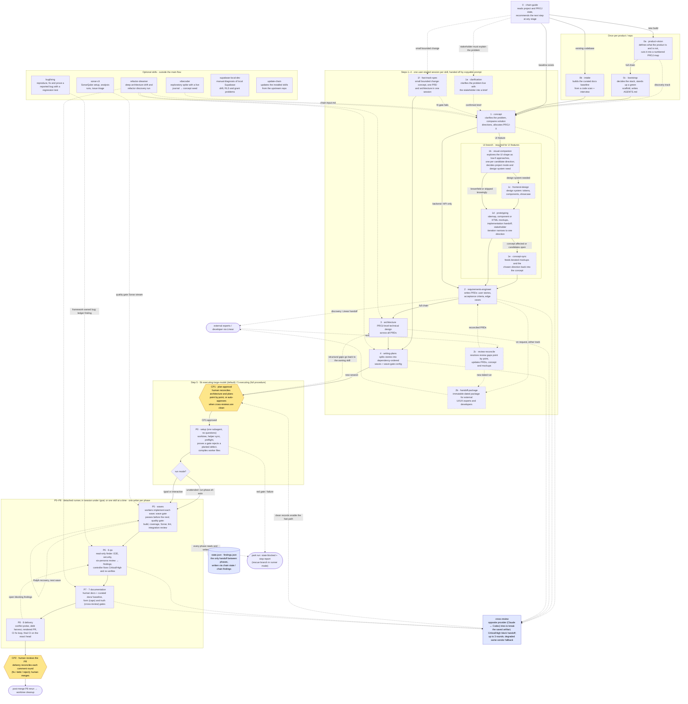

# Agentic Development Skill Chain

An opinionated skill chain for agentic software development, maintained in
parallel for Codex and Claude, plus an agent workflow framework that runs
the execution half of the chain unattended — dual provider lanes, machine-
readable state, a findings ledger, and hard gates instead of good
intentions.

Not a developer, or just want the plain-language version of what this does
and why? Start with [docs/WHY.md](docs/WHY.md).

The chain clarifies the problem before turning a rough product idea into a buildable concept, explores UI
shape when needed, writes requirements, creates architecture and
implementation plans, executes the work wave by wave, runs QA, curates
documentation, and delivers a PR. Two human checkpoints frame the
autonomous middle: plan approval before execution starts (CP1) and PR
review after delivery (CP2).

Before the first PROJ it runs once at the product level: a new build goes
through `product-vision` (what the product is and is not, plus a numbered
PROJ map) and `bootstrap` (the stack decided into one table, the real
scaffold stood up, agent files written); an existing codebase goes through
`intake`, which reaches the same curated baseline by extraction.

The baseline has nine files: root `AGENTS.md` and `docs/{PRODUCT,ARCHITECTURE,GUIDELINES,DESIGN-SYSTEM,components,security-baseline,test-conventions,review-checklist}.md`.
The two UI files are conditional. GUIDELINES holds target-state rules and at most
10 project-specific Traps within 120 lines; review-checklist holds project antipatterns
and Known Debt within 80 lines and is required to seal. Reviewers and QA read it;
implementers read it by path only during self-review after writing. See the
[rule placement contract](CONCEPT.md#trap-test-and-rule-placement).

## The Chain



Dashed boxes are optional skills, yellow hexagons are the two human
checkpoints, and dotted edges are optional or conditional paths, loops,
automatic cross-review calls, or stop-policy exits.

| Step | Skill | What it does |
|------|-------|--------------|
| 0 | `chain-guide` | Detect project state, route to the right next step; advise which flow fits a new task |
| 0a | `product-vision` | Once per product, new build: interview into `docs/PRODUCT.md` (what/who/non-goals) and cut the product into a numbered PROJ map in `specs/product-roadmap.md` |
| 0b | `intake` | Once per repo: bootstrap the curated docs baseline from a code scan (provenance-marked drafts) + developer interview, reconciled via checkpoint, sealed as a commit |
| 0c | `bootstrap` | Once per project, new build: decide the stack into `docs/ARCHITECTURE.md` § Stack, run the real scaffold, verify build/test green, write root `AGENTS.md` + `CLAUDE.md` pointer |
| 1a | `clarification` (opt) | PM and stakeholder clarify the problem live into a standalone stakeholder brief in `specs/_clarification/` |
| 1 | `concept` | Clarify the problem (or use a supplied brief), then open the solution space, compare directions, allocate PROJ-X, and write the concept |
| 1b | `visual-companion` (UI req.) | Interactive layout exploration, project mode detection; prototypes each open candidate direction |
| 1c | `frontend-design` (opt) | Design system — tokens, component catalog, showcase page |
| 1d | `prototyping` (UI req.) | HTML sitemap + component-based or standalone HTML mockups + implementation handoff; narrows carried-forward candidates to one |
| 1e | `concept-sync` (opt) | Reconcile iterated mockups and the chosen candidate direction back into the concept |
| 1f | `fast-track-spec` (opt) | Compressed entry for a small, bounded, non-bug change: thin concept, one PRD and the architecture in one session with one interview and one cross-review; the standard artifacts, so Step 4 onward is unchanged. Escalates to `concept` when the task is bigger |
| 2 | `requirements-engineer` | PRDs: user stories, acceptance criteria, edge cases, required opposite-provider review before handoff |
| 2b | `handoff-package` (opt) | Standalone zippable package for external experts |
| 2c | `review-reconcile` (opt) | Resolve PRD review gaps point by point |
| 3 | `architecture` | PROJ-level tech design across all requirements; hands off to a new Step 4 session after cross-review |
| 4 | `writing-plans` | Wave-based implementation plans; hands off to a new Step 5 session, whose CP1 is the joint planning approval |
| 5 | `executing` | Full-procedure Step 5 for weaker writer models; hosts the CP1 `checkpoint` and P0 `setup` subskills and the framework scripts that `5b` uses too |
| 5b | `executing-large-model` | **Default Step 5**: CP1 + P0 through the `5_executing` subskills, then the waves with the same gates, state, and QA handoff as `executing`, procedure replaced by intent and invariants |
| 6 | `qa` | End-to-end QA plus the required opposite-provider six-persona review; read-only finder in framework runs, findings into the ledger. Fast-track PROJs get a risk-scaled QA profile (shallower, not more lenient): a reduced persona panel unless a risk signal or a Critical/High finding escalates to full |
| 7 | `documentation` | Human docs + curation of the long-lived `docs/` baseline behind form and truth gates |
| 8 | `delivery` | Conflict probe, PR with rendered body, CI fix loop, CP2 comment reconcile |

A bare number is a main-line step; a letter suffix is a variant at the same
stage — `1b`–`1e` are a sequence inside the UI branch, `2b`/`2c`
optional forks after Step 2 (`2b` packages PRDs for external experts on
either track; `2c` runs when a developer review returns gaps and
reconciles them back into PRDs, concept and mockups), `0a`/`0b`/`0c` alternative entry paths, `1f` a compressed entry path that replaces steps 1–3 for a small change. Checkpoint 1 and P0 setup are
subskills in `5_executing/subskills/`, not steps of their own; `5b` is the
default Step 5 and `5` its full-procedure fallback. Skills with no number are not steps (see below). Inside
`specs/PROJ-<X>-<theme>/`, each subfolder carries the number of the skill
that writes it.

Concept can decompose one broad seed into multiple PROJs; downstream
skills handle one PROJ at a time with sibling PROJs as dependency context.

The same skills serve two delivery tracks: the full in-repo build and a
**product discovery** track for pure product management — concept,
wireframe, mockup, iterate with stakeholders, then hand a PRD to a
developer via Linear at Step 2, no codebase required. See
[docs/pm-chain.md](docs/pm-chain.md).

## Receiving a product handoff

The existing linear chain remains unchanged. External handoffs separate three
responsibilities:

- **Prototype repo — Product:** concepts, prototypes and PRDs, delivered as versioned packages.
- **Refinement location — shared coordination:** shared package, decision, dependency and integration records, plus shared engineering analysis as agreed by the team. A separate refinement repo is optional; the prototype repo or a production repo works equally, with the refinement project as a sibling of the product project (`specs/PROJ-<X>-<theme>-refinement/`), never inside it.
- **Production repos — Engineering:** scoped, pinned refinement inputs and readiness records alongside architecture, implementation plans, tests and PRs, with execution state owned by each repo.

Start with optional `handoff-refinement` (2e): it finds or records the coordination
location, identifies each code repository's baseline status, then inspects the
immutable product package against code, records engineering constraints, and
prepares questions for the product team.
Each refinement is one run under `specs/PROJ-<id>-<theme>/runs/<date>-<nn>/`
(in the handoff's source repository a `-refinement` sibling of the product project)
with the received files kept unchanged and every new result marked as proposal,
question, checked or approved. Explicit product answers unblock the affected
scope; model review cannot approve product changes.

Architecture and plans consume the pinned product baseline, approved answers and
separate engineering requirements. Independently verifiable technical work, such
as a shared migration, can become an optional engineering story with its own
rationale, criteria and tests. Smaller implementation tasks stay within their
product story; received PRDs remain unchanged. Each implementation repository
keeps its own checkout, state, tests and PR. Shared integration evidence establishes
completion across repositories.

See [the receiving workflow](docs/skill-chain.md#external-product-handoffs) for
ownership, setup and the return path to product.

## The Agent Workflow Framework

Once Step 5 has sealed P0, it asks once whether to run P5 to a PR unattended,
drive it in this session under `/goal`, or continue interactively. Unattended
starts the host-neutral phase runner detached (`runner/run-phase.sh auto`,
P5 → P6 → P7 → P8); in the morning you read the run's one-line summary and
the PR body, then review the PR (CP2).

What makes that trustworthy, in short: dual Claude + Codex lanes with exactly
one writer per phase, `state.json`/`findings.json` as the only handoff,
script-verified gates the runner re-checks itself, provider-opposite
cross-review on every gated artifact, and a stop policy that parks a run
instead of continuing degraded. Reports and PR bodies are rendered from state
and ledger, never hand-written.

- New to the framework? [docs/how-it-works.md](docs/how-it-works.md) maps the
  scripts (`chain <verb>`), the P0–P8 phases and the gates on one page.
- Runner mechanics: [docs/skill-chain.md](docs/skill-chain.md#framework-runs-agent-workflow-stage-1--stage-2).
- The runner's invariants, pinned models, degraded mode and stop policy:
  [runner/README.md](runner/README.md#invariants-the-runner-owns).
- The unattended handoff question and launch block:
  [unattended-handoff.md](claude/skills/5_executing/references/unattended-handoff.md).
- The full model and rationale: `CONCEPT.md`. Its Stage 3+ (P3 runner rework,
  deeper pre-mortem orchestration, Jira import, optional per-story worktree
  parallelism) is not built yet; the producing-skill cross-review handoffs
  are already wired.

## Outside the Chain

`cross-review` is not a chain step and is never routed to directly: the
producing skills invoke it automatically on their saved outputs, and the
provider opposite the author tries to break the artifact (Claude-authored →
Codex, Codex-authored → Claude; QA runs six isolated discipline reviewers).
Review rounds, severity gates and the loudly flagged degraded fallback are
defined in [claude/skills/cross-review/SKILL.md](claude/skills/cross-review/SKILL.md#routing-and-output-integrity);
the model rank the runner pins for review lanes is in
[runner/README.md](runner/README.md#invariants-the-runner-owns).

## Optional Skills

```text
2e_handoff-refinement
bugfixing
refactor-dreamer
sonar-cli
supabase-local-dev
update-chain
vibecoder
```

Each sits outside the main 0–8 flow — a standalone repair workflow, an
exploratory or discovery run, or standalone tooling. See [docs/skill-chain.md#optional-skills](docs/skill-chain.md#optional-skills)
for what each one does and when to reach for it.

Claude-specific experimental or personal skills are intentionally excluded.

## Repository Layout

```text
codex/skills/    Codex version of the chain
claude/skills/   Claude version of the chain
runner/          Host-neutral dual-lane phase runner, schemas, report templates, release-gate spikes
docs/            Human documentation for this repository
scripts/         Install and validation helpers
CONCEPT.md       The agent workflow framework specification
```

`AGENTS.md` is the only curated durable-context file. `CLAUDE.md` is
pointer-only and tells Claude to read `AGENTS.md`.

Framework helper scripts (`chain state`, `chain findings`, the context compiler,
gates, adapters) are byte-identical across their skill copies — `validate.sh`
enforces it.

## Install

```bash
./scripts/install.sh
```

It checks the prerequisites ([Claude Code](https://code.claude.com/docs/en/setup),
[Codex](https://github.com/openai/codex), bash >= 4.4, `git`, `jq`, Node.js LTS >= 22,
and `perl` where `timeout` is absent), lists everything missing at once and offers to install it (showing the
exact commands first), then installs both chains and offers the optional Sonar CLIs.
Start newly installed `claude` and `codex` once to sign in. On a single-provider
machine run `./scripts/install-claude.sh` or `./scripts/install-codex.sh` alone.

The installers copy the bundled core chain and optional skills into the
default local skill directories as one unit (no per-skill install). The macOS (bash >= 4.4) and
Windows (WSL2) notes are in [docs/installation.md](docs/installation.md).

After pulling updates, run `./scripts/check-setup.sh`: it reports tools below
the checkout's required versions and installed skills that no longer match it,
and exits 1 when `./scripts/install.sh` is needed (it can also run from an
optional local git hook)
([details](docs/installation.md#after-pulling-updates)).

To remove it again, run `./scripts/uninstall.sh`: it removes the chain's skill
folders (and a leftover Ponytail plugin, now retired), asking before each, and leaves Claude Code, Codex and your
other skills installed ([details](docs/installation.md#uninstall)).

## Validate

```bash
./scripts/validate.sh          # structure, frontmatter, byte-identical helpers, schemas, syntax, behavior harnesses
runner/spike-dual-lane.sh      # Stage 1 release gate: live dual lanes, ledger guarantees, stop policy
runner/spike-stage2.sh         # Stage 2 release gate: live Claude/Codex review adapter smoke (makes real CLI calls)
```

`validate.sh` is the pre-publish check for this repository; the exact checks
and the deterministic behavior harnesses (run concurrently on their own
fixtures, never contacting external services) are in
[scripts/validate.sh](scripts/validate.sh). The two spikes are the
framework's release gates, described in [runner/README.md](runner/README.md).

## Inspirations

This repo was shaped by ideas from:

- [Get Shit Done](https://github.com/majiayu000/claude-skill-registry/tree/main/skills/data/get-shit-done)
- [Superpowers](https://github.com/obra/superpowers)
- [Ponytail](https://github.com/DietrichGebert/ponytail) (used as a plugin until 2026-10-26; its ideas live on in the role manifests)
- [Alex Sprogis](https://www.alexsprogis.de/)
- [Matt Pocock](https://github.com/mattpocock)

## License

MIT
