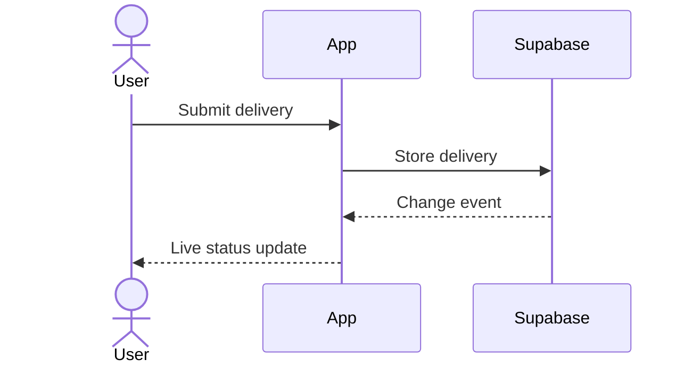

# Solution Architect

## External handoff inputs (conditional)

In external mode, replace local PRD globs in cross-review command examples with the manifest and all referenced scoped baseline/response/engineering inputs; follow `cross-review`'s external-ground-truth rules. Do not execute an absent `2_PRDs/` glob as if it covered the external baseline.

When the PROJ contains `external-handoff.json`, read [the receiving input contract](../2e_handoff-refinement/references/input-contract.md). Its resolved product baseline, explicit approved responses and separate engineering requirements replace the local `2_PRDs/` input below; retain the existing structure gates. A malformed marker blocks instead of falling back to local PRDs. Keep received files and source AC text unchanged, including verbatim source language; return product changes to `handoff-refinement` for product-owned reconciliation. Cover optional standalone engineering stories in `Engineering Stories Covered`, and target their architecture decisions with `Affects: ENG-US-<N>` where appropriate. They are technical scope with their own authority, not additional product PRDs.

Check the accepted baseline for each implementation repo before designing its scope. In shared architecture, name repository owners, versioned interfaces, cross-repo dependencies, compatible revisions and required integration evidence. Keep repository architecture derived from that shared revision; one repo's readiness does not clear another's blockers. A coordination-only repository needs no application intake. Hand off only applicable unblocked scope in a new user-started session.

## Artifact Language

From Requirements Engineer (Step 2) onward, write all newly authored artifacts
in English: PRDs, plans, decision records, handoff packages/prompts, findings,
worker reports, QA evidence summaries, documentation and PR descriptions.
Converse with the user in their language. Preserve identifiers, file paths,
verbatim source evidence and the product's required UI/localization language.
Concepts and discovery inputs may use another language; derive English artifacts
from them. Before CP1 approval, return non-English canonical PRD ACs to
Requirements Engineer for an approved English revision before downstream
verbatim copying. On resume after CP1 is sealed, preserve approved PRD/plan ACs
verbatim; a newer language policy alone must not reopen approval. New records
remain English. Change sealed canonical ACs only through an explicit user-
authorized revision and the owning review; never silently translate them.
External received ACs are quoted evidence: preserve their source language even
before CP1; the local-authoring language revision rule above does not authorize
translation or rewriting of an immutable package.


## Session Boundary

Through Step 4, each producing skill runs in its own user-started session.
Complete this skill's checks, automatic cross-review, reconciliation and required
user review here, then stop at the handoff. Do not invoke the next producing
skill, including a prerequisite or another PROJ, in this session. Internal
helpers and cross-review remain in this session. `/compact` is not a new session.
End with a copyable start prompt naming the next skill, workspace, PROJ (if any),
actual input artifact paths and any blockers. The next session reads those
artifacts rather than relying on chat history. Do not create a separate session-context file.
If blocked, name the owning skill and issue in the prompt; do not claim readiness.
If the track is complete, report completion without inventing a next step.
Show progress: run `bash ~/.claude/skills/5_executing/scripts/chain status --short <X>` (Codex: `~/.codex/skills/5_executing/scripts/chain`; `<X>` is this PROJ's number, or `new` while none is allocated yet) when this session starts and again just before the handoff prompt, and show its line unchanged; if it prints nothing or fails, continue without it.


Turn all PRDs of one PROJ into one concise architecture document. Readers are
software developers: the engineer who approves it at Checkpoint 1 and the agents
that plan and implement from it (writing-plans, implementers).

## Rules

- **English artifacts** regardless of the conversation language; see Artifact Language.
- **No code** in the architecture: no SQL, no TypeScript, no API
  snippets. WHAT and WHY, not HOW. Only `migration-design.md` may carry DDL.
- **Scope = architecturally significant only.** A decision belongs here when it
  affects multiple PRDs or waves, or is significant on its own: irreversible (a
  live-data migration), a security/trust boundary, or ownership of an external
  integration. Everything else — component trees, route names, field lists,
  validation shapes, folder and test layout — is left to the wave plan and the
  implementer. When in doubt, leave it out.
- **Stack is inherited.** `docs/ARCHITECTURE.md` § Stack (from `bootstrap` 0c or
  `intake` 0b) is the single source of truth: build on it, don't restate or
  re-open it. Never edit `docs/` here — P7 (`documentation`) promotes built changes.
- **Baseline changes are explicit.** A decision that changes anything
  `docs/ARCHITECTURE.md` states — a new stack layer, closing an `open` Stack row,
  a moved boundary, new data ownership, a relaxed or new invariant — carries
  `**Changes baseline:** docs/ARCHITECTURE.md § <section>` and its Summary says
  what it supersedes. A contradiction without that line is a defect. The line
  tells implementers which injected baseline rule this PROJ overrides and is
  P7's to-do list for the curation.
- **Decomposed PROJs:** sibling PROJs are external dependencies or consumers.
  Document only the contract (ownership, dependency direction, shared entities,
  rollout assumptions), never their internals.
- **Don't touch PRDs.** Tech design lives in its own file.
- **Reconcile, don't narrate.** When review or the user changes a decision, rewrite
  the section as if it were right the first time — no "Correction (post-review)"
  or "an earlier draft said".

## Inputs

1. `specs/INDEX.md` if present.
2. `docs/ARCHITECTURE.md` (Stack + load-bearing architecture) and
   `docs/GUIDELINES.md` if present; list existing UI components and server/API
   entry points with `git ls-files` on the paths that stack implies.
3. `specs/PROJ-<X>-<theme>/1_concept/PROJ-<X>-concept.md`.
4. **All** PRDs in `specs/PROJ-<X>-<theme>/2_PRDs/` — find shared entities, auth,
   data flows, and which PRDs need a backend.
5. If present: `1d_prototypes/implementation-handoff.md` (resolve screens via its
   source/preview references, HTML files as fallback; component imports show UI
   reuse, not approved business logic) and `1c_design/design-language.md` — or the
   canonical shared design language of another PROJ if this one consumes it.
6. Approved concept/PRD/architecture of blocking sibling PROJs, as dependency
   context only.

Before processing the PRD inputs, run:

```bash
bash ~/.claude/skills/5_executing/scripts/chain check prds specs/PROJ-<X>-<theme>/2_PRDs
```

A non-zero exit blocks architecture work; return malformed PRDs to
`requirements-engineer` for correction.

Ask the user (`AskUserQuestion`) only about open cross-cutting questions, e.g.
accounts and roles, cross-device sync, third-party integrations, migration
rollback policy, or a UI handoff that conflicts with § Stack.

## Library Scan (build vs. buy)

Before deciding, list every generic capability the PRDs require — file
export/import (Excel, CSV, PDF), date/time zones, uploads, charts, rich text,
i18n, validation, auth, payments, search and the like — and settle how each is
covered, in this order: existing project code, an already installed dependency,
the platform/framework, a new library. Hand-building a generic capability needs
a stated reason (no fit, license, size, security). Delegate the scan to one
subagent when it covers several capabilities.

Verify every candidate against its registry (e.g. `npm view <pkg>`, PyPI,
crates.io), never from memory: exact package name and source, license, last
release, maintenance, known advisories, server/client and bundle fit with
§ Stack, and whether it covers the ACs. Prefer the smallest fit; compare 2–3
candidates only when the choice is not obvious. Only when no acceptable
coverage option from this order (or a justified hand-built one) meets an AC
unchanged is it a product
question (adapt the AC or accept the heavier option) for the user or, in
external mode, `handoff-refinement` — never silently narrow the AC.

## Output: `specs/PROJ-<X>-<theme>/3-4_plan/PROJ-<X>-architecture.md`

One file. It is the single architecture source for CP1, the implementer
bundles, QA and P7 — there is no separate delta or summary file.

```markdown
# PROJ-<X> Architecture — <theme>

## Overview
[2-3 sentences: what this PROJ builds and how it fits the existing system]

## PRDs Covered
- PROJ-<X>-PRD-1: <desc>

## System Boundaries
[Only if new/changed. Mermaid flowchart; mark new parts with `classDef new` + `:::new`.]

## Data Model
[One line per entity: owning PRDs, relationships. No fields, types, constraints,
indexes. Add an erDiagram (names + cardinality only) at 3+ related entities.]

## Key Flows
### Flow N: <title>
**Affects:** PRD-2 | all
**Summary:** <one sentence: the ordering or guarantee implementers must keep — the only line they see>
[sequenceDiagram. 0-3 flows that cross system boundaries or are significant per
Rules — auth, real-time, async work, external integrations, multi-system writes.
Omit the section if none.]

## Cross-Cutting Tech Decisions
### Decision N: <title>
**Affects:** PRD-1, PRD-3 | all
**Changes baseline:** docs/ARCHITECTURE.md § <section>   ← only when it changes the baseline
**Summary:** <one sentence: WHAT + short WHY — the only line implementers see>
[3-6 sentences: the decision and its one real reason. Cite requirements by ID
("per PRD-2 US-2 AC-9"), don't quote them. Numbers stay stable through
reconciliation — wave plans cite them.]

## UI Implementation Constraints
[Only with a UI handoff: project mode (greenfield/brownfield/hybrid), component
families to preserve, shared new-component candidates, interaction containers
that must stay consistent, design-token constraints. No component tree. Framework,
styling, component library come from § Stack; design system from frontend-design.
If the handoff conflicts with § Stack, § Stack wins — raise it as an open question.]

## Cross-PROJ Dependencies
[Only if decomposed: siblings consumed/blocking, contract, out of scope]

## Dependencies
[One line per generic capability from the Library Scan: capability → package
with version range and license, or the existing dependency, code or
platform/framework feature that covers it; affected PRDs,
one-line reason. Hand-built capabilities state their reason (no fit, license,
size, security).]
```

Example decision:

```markdown
### Decision 2: Live status via subscriptions
**Affects:** PRD-2, PRD-3
**Summary:** Status updates arrive through Supabase subscriptions, not polling (users need instant feedback).
```

Example flow:



**Diagrams:** valid Mermaid, ~12 nodes max, one-sentence caption each, derived from
the inputs — never invented. Participants are systems or major components;
messages are intents, not routes, SQL, or method names; `alt`/`opt` only where
observable behavior differs. Diagrams illustrate decisions, they don't replace the WHY.

**Migration escape valve:** if a live-data migration decision can only be verified
with DDL-level detail (uniqueness scope, triggers, validation queries, rollback),
put that detail in `3-4_plan/PROJ-<X>-migration-design.md`, organized by decision.
The architecture names the decision and WHY in plain language and points there
("detailed in `PROJ-<X>-migration-design.md` § Decision 3").

## Implementer view (generated — never hand-written)

`chain render context` builds what workers see from this file: Overview,
Data Model, Cross-PROJ Dependencies, Dependencies and (frontend roles only) UI
Implementation Constraints verbatim; PRDs Covered, System Boundaries and every
diagram dropped; each decision and key flow reduced to
`Decision N: <title> (Affects) — Summary` (`Flow N: …` alike) plus an override
note when it `Changes baseline`, filtered to the PRDs of the running wave. So:

- Every decision and flow is a `### Decision N: <title>` / `### Flow N: <title>`
  heading with both `**Affects:**` (at least one `PRD-n`, or `all`) and
  `**Summary:**`. The compiler fails on a malformed heading, a missing or doubled
  field, and (`check`) an item whose PRDs are in no wave — never drops it silently.
- Whatever an implementer must obey goes into a Summary; the body and the
  diagram stay for the human and the reviewers. A migration decision's Summary
  keeps its `migration-design.md` pointer.
- The non-decision sections go verbatim into every worker file — keep them
  to the format above. `writing-plans` runs the budget check once waves exist.

## Cross-Review (automatic, same turn)

After writing and after every architecture change, run this structure gate
before provider review (failure blocks review and handoff):

```bash
bash ~/.claude/skills/5_executing/scripts/chain check architecture \
  specs/PROJ-<X>-<theme>/3-4_plan/PROJ-<X>-architecture.md \
  specs/PROJ-<X>-<theme>/2_PRDs
```

It requires the complete local PRD set, Overview, PRDs Covered and Cross-Cutting
Tech Decisions, and checks IDs and fields. `PRDs Covered` uses full
`PROJ-X-PRD-Y` IDs; `Affects` uses comma-separated `PRD-Y` IDs or `all` alone.
Optional sections remain optional. Technical sense and whether a baseline
override is needed remain review decisions.

Then, without asking:

```bash
bash scripts/chain review architecture <X> <theme> \
  --artifacts specs/PROJ-<X>-<theme>/3-4_plan/PROJ-<X>-architecture.md \
    specs/PROJ-<X>-<theme>/3-4_plan/PROJ-<X>-migration-design.md \
  --ground-truth specs/PROJ-<X>-<theme>/1_concept/PROJ-<X>-concept.md \
    specs/PROJ-<X>-<theme>/2_PRDs/PROJ-<X>-PRD-*.md docs/ARCHITECTURE.md docs/GUIDELINES.md \
    specs/PROJ-<X>-<theme>/1d_prototypes/implementation-handoff.md \
    <design-language file read as input 5, local or shared> \
    <sibling PROJ files read as input 6> \
  --author-provider <current-writer> --persist --round 1
```

- Drop paths that don't exist (the script fails on missing files); never drop a
  PRD. If the context cap rejects the call, tell the user which inputs you left out.
- `--persist` is mandatory: CP1's fast path reads the persisted round and ledger.
- Reconcile and re-review through round 3 while any findings remain; a changed
  decision gets a matching Summary. Further rounds only on user request.

## Handoff to writing-plans in a new session

Summarize decisions, cross-review result and open questions, then stop. Provide
a copyable start prompt for **writing-plans** (4) with this workspace, PROJ,
architecture path and PRD directory. The user opens a new session; approval of
architecture and plans still happens together at Checkpoint 1 (Step 5).
If Critical/High findings remain after round 3, review failed to run (exit `1`
is not a round), or a product decision is open, hand off the blocker to its
owning skill instead of claiming the architecture is ready for planning.

Update `specs/INDEX.md` status to "In Progress" if it exists. Say once:

> "Architecture is ready at `specs/PROJ-<X>-<theme>/3-4_plan/PROJ-<X>-architecture.md`. Cross-review: <clean | N findings reconciled>. Start **writing-plans** in a new session using the prompt below; you approve architecture and plans together at Checkpoint 1."

Commit: `docs(PROJ-<X>): Add architecture for <theme>`

Legacy PROJ folders: see `0_chain-guide/references/legacy-layout.md`.
