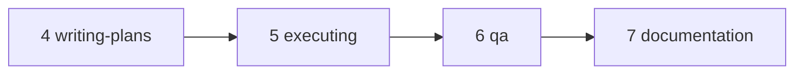
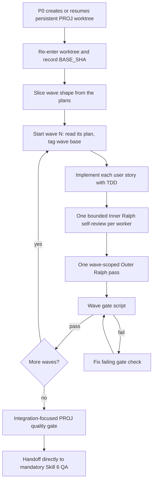
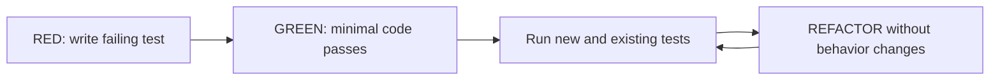

# Executing Skill

**Last updated:** 2026-10-14

CP1 repeats `chain check prds`, `chain check architecture` and `chain check plan` before approval, including after cascaded edits. Malformed inputs return to the owning skill. Existing approved P5 runs retain the context compiler's legacy fallbacks.

The executing skill is Step 5 in the 0-to-8 chain. It turns the wave plans from Step 4 into working code, one PROJ at a time, with deterministic verification once per wave and hard gates between waves.

Its main job is orchestration. When delegation is available, workers own every code, test, and fix edit. The lead owns decomposition, dispatch, integration, deterministic verification, gates, commits, and operational records. Disjoint work runs concurrently; dependencies and overlapping ownership run serially. Local editing is only a visible fallback when delegation is unavailable or prohibited.

## Where It Fits



Inputs:

- Wave shape: each plan's `## User Stories in this Wave` and `## Execution`, sliced with `chain render slice` (read at PROJ start)
- Wave plans in `specs/PROJ-<X>-<theme>/3-4_plan/PROJ-<X>-wave-<N>-plan.md` (one per wave, read at that wave's start)
- PRDs in `specs/PROJ-<X>-<theme>/2_PRDs/PROJ-<X>-PRD-*.md` (authoritative; opened only when a plan/PRD AC conflict is suspected)
- Architecture in `specs/PROJ-<X>-<theme>/3-4_plan/PROJ-<X>-architecture.md` (on demand; workers get its compiled implementer view — their wave's decision Summaries — through their worker file; projects planned before Summary lines existed get `architecture-delta.md`, else the whole file unfiltered)
- Gate config in `specs/PROJ-<X>-<theme>/3-4_plan/wave-gate-config.json`
- UI handoff in `specs/PROJ-<X>-<theme>/1d_prototypes/implementation-handoff.md`, when the PROJ has UI work

Outputs:

- Implemented and committed code
- `specs/PROJ-<X>-<theme>/5_progress/PROJ-<X>-progress.md`
- Optional source-local `agent.md` notes for non-obvious gotchas
- A QA-ready PROJ handoff to Step 6

## Core Lifecycle



The loop is intentionally continuous. A green wave gate is the signal to start the next wave; the lead does not stop for user confirmation between waves unless there is a blocker.

## Preflight

Before implementation starts, P0 prepares the environment because later gates depend on specific tools and config: a persistent sibling worktree on `proj/PROJ-X` (P5–P8 execute there) with its own dependencies and a linked `.env.local`, the synchronized framework helpers, the CodeRabbit config, the tool and auth preflight, and `BASE_SHA`. The development database and hosted-auth budget stay shared across worktrees, so migrations and auth-consuming commands run under the common lock, and on a Supabase project every wave gate re-checks the shared DB's applied migrations against this worktree's `supabase/migrations/`, since the lock does not stop a sibling worktree from advancing the schema in between. The worktree contract is in [P0 step 1](../claude/skills/5_executing/subskills/setup.md#1-persistent-proj-worktree--base_sha), the tool list and migration-drift check in [P0 step 4](../claude/skills/5_executing/subskills/setup.md#4-tool--auth-preflight), the whole P0 sequence in [How the Chain Works](how-it-works.md#p0-one-setup-run).

`progress.md` is the short-term memory and proof log for the whole PROJ. If it is missing, execution stops and creates it before continuing.

## Memory Files

### `progress.md`

`progress.md` tracks the active wave, user-story task status, tests, acceptance-criteria evidence, recovery stages, gate results, and blockers.

It is updated after every meaningful action:

- After each TDD task cycle.
- After each bounded Inner Ralph result and each wave-scoped Outer Ralph recovery stage.
- After wave gates.
- After quality-gate checks.
- Whenever a blocker appears.

The most important proof blocks are the wave gate blocks:

```markdown
### Wave N Gate - PASSED
```

Those blocks are appended by `scripts/chain gate wave`. Manual checklist edits are not enough to prove a wave is complete.

### `agent.md`

`agent.md` is long-term developer memory for non-obvious project gotchas. It lives near the feature source, such as `src/features/<feature>/agent.md`.

Use it sparingly. Good entries describe project-wide behavior that future implementers would otherwise rediscover, such as framework quirks, tooling traps, or dead ends.

## Wave Execution

Each PROJ is split into numbered waves by Step 4. Each wave contains one or more user stories. One story is one worker; the lead splits a story only when its plan header declares `Split: contract` (backend and frontend workers against `api-contracts.md`) or `Split: fan-out` (same-shaped units over disjoint files). An oversized story without such a marker is a planning defect for Step 4, not a runtime decision.

This page describes the full-procedure `5_executing`. The chain's default Step 5 is `5b_executing-large-model`, with the same inputs, outputs, and gates and less procedure; `5_executing` remains the choice for weaker writer models. Rules both skills share (finding triage, test-evidence rules) live once in `references/`; 5b only points to them and is size-capped. See [skill-chain.md](skill-chain.md#step-roles).

Before a wave starts:

1. Read relevant `agent.md` notes.
2. Verify the previous wave has a passed gate block, if this is not wave 1.
3. Tag the current HEAD as the wave base:

```bash
git tag "wave-${WAVE}-start-PROJ-${PROJ}"
```

The wave base tag scopes the CodeRabbit review inside the wave gate. Without the tag or `WAVE_BASE_SHA`, the gate fails.

A story worker's role comes from the plan's `Agent Type` column, never from the lead's judgment, and each worker reads exactly one compiled file (`context/workers/wave-<N>/<US-ID>.md`, a fix worker `context/roles/wave-<N>/<role>.md`) named by path in its spawn prompt; nothing is pasted. What that file contains and how the role manifests fill it is described in [What a worker file contains](how-it-works.md#what-a-worker-file-contains) and compiled by [P0 step 6](../claude/skills/5_executing/subskills/setup.md#6-worker-context-compile-worker-files-ground-file). The lead adds only what the file lacks (execution mode, ownership and lock rules, a prior-wave summary); the worker's report starts with `Brief: <US-ID>`.

Parallel waves run several independent stories at once; the lead owns file ownership, the dev server, the shared-resource schedule and every worker stop or replacement. Single-story waves do not need team overhead. Migrations and auth-consuming commands run under `chain worktree with-shared-lock` (exclusive by default; a lock timeout is infrastructure failure, exit 73). Worker status, handover, the shared and exclusive lock modes and their diagnostics are defined once in the [worker lifecycle and resource guide](../claude/skills/5_executing/references/worker-lifecycle.md) and [P0 step 1](../claude/skills/5_executing/subskills/setup.md#1-persistent-proj-worktree--base_sha).

## TDD Task Loop

Each user-story implementation follows a task-level TDD loop:



Rules:

- No production code before a failing test.
- The failing test must fail for the expected reason, not because of import or setup errors.
- After the fix, run the relevant tests and existing regression tests.
- Refactors must not add behavior.
- The implementer must report actual commands and observed results.

## Inner Ralph Self-Review

After all tasks for a user story are implemented, its worker reads `docs/review-checklist.md` by path (never injected into its bundle), then runs one bounded self-review covering task/spec compliance, error handling, type safety, test quality, boundaries, and architecture. The worker fixes confirmed issues once, reruns targeted tests, and reports unresolved issues without starting another self-review cycle.

Existing Known Debt is not re-flagged; changes that spread it are flagged.

The implementer does not verify acceptance criteria. That is reserved for the lead's wave-scoped Outer Ralph pass.

## Wave-Scoped Outer Ralph

Before the AC pass, complete the same closure checklist in parallel and sequential modes:

1. Match every story's `Smoke Test` route and behavior to gate smoke or current-wave authenticated scenario coverage.
2. Assign missing scenarios to the named browser owner after conflicting DB work releases resources; an existing story worker can own them.
3. Integrate and commit scenario files, command/route mappings and any selection-only hook. Prefer files per wave or cohesive feature; a route load alone does not prove an interaction.

After every worker returns and this coverage is committed, the lead starts the canonical wave acceptance checks with:

```bash
bash scripts/chain gate wave --ac-only <N> <X> <theme>
```

This AC-only pass uses the gate's timeout, auth-budget, pacing, and rate-limit controls and writes its results directly to `ralph-wave-<N>.json`. It collects every ordinary AC failure so disjoint repairs can be batched, while infrastructure and auth-budget exhaustion still fail fast. It exits before regressions, build, CodeRabbit, browser smoke, component registry, progress certification, and next-wave tagging.

Evidence binds each canonical AC ID, task, exact command, test files, selected-test count, and committed `HEAD`; a pass is reused only on the same `HEAD` and gate-config fingerprint, and every correction commit invalidates it. The reuse and sharing rules are in [Outer Ralph](../claude/skills/5_executing/SKILL.md#4-wave-scoped-outer-ralph-ac-verification).

An AC that waits for an authorized external prerequisite keeps its command and test files and declares `external_dependency`; its read-only check decides whether the AC runs or is recorded as `blocked_external` (exit 76), which neither certifies the wave nor unlocks the next one and is not a waiver. The key's fields, the checker's exit codes and the replanning rule are in the [gate-config contract](../claude/skills/4_writing-plans/references/wave-gate-config.md#judgment-rules).

Recovery has exactly four stages:

1. Normal fix round 1, clustered by disjoint ownership.
2. Normal fix round 2 with fresh workers.
3. Fresh diagnosis without edits.
4. A different implementer applies the diagnosis.

After each edit is committed, the lead reruns the same `--ac-only` command. The new `HEAD` conservatively invalidates all earlier AC passes. If failures remain after stage four, or diagnosis finds an invalid or contradictory AC, execution uses the existing blocked-run evidence path. It does not loop indefinitely or weaken the AC.

## Wave Gate

The wave gate is the hard boundary between waves.

```bash
bash scripts/chain gate wave <N> <PROJ-X> <theme>
```

It proves, in one script run, the wave's ACs, the declared targeted regressions, the optional static checks, the browser smoke, the component registry, the build and the CodeRabbit review; it never runs Sonar. A regression suite covers only the shared behavior the wave touches (broad hosted-auth and browser suites belong in the `quality`/CI/nightly phases), and declared test files above 800 lines get an advisory warning, not a failure.

If the script exits non-zero, execution stops at that gate: a missing external prerequisite (exit 76) waits for readiness, lock contention (exit 73) needs resource diagnosis, and code corrections go to a follow-up worker before the rerun. On success the script appends the canonical passed block to `progress.md`, which proves the current wave plus its declared regressions, not that earlier waves' ACs were rerun. Legacy string AC entries are rejected; such a plan goes back to Writing Plans for the structured metadata and a new approval. The checks, their order, evidence reuse and the config keys are defined once in the [Wave Completion Gate](../claude/skills/5_executing/SKILL.md#wave-completion-gate) and the [gate-config contract](../claude/skills/4_writing-plans/references/wave-gate-config.md).

## Build Policy

The skill avoids scattered build checks.

- Wave builds run inside `scripts/chain gate wave`.
- The PROJ quality gate can reuse the final wave build when declared `build_artifacts`, inputs and command still match; otherwise it runs a fresh build. Code fixes invalidate old proof.

If a build fails, a fix worker gets the verbatim compiler output and the failing gate is rerun.

## CodeRabbit and Smoke Tests

CodeRabbit is mandatory per wave unless `wave-gate-config.json` sets `coderabbit.enabled: false` (an optional switch, default on, set only when the user explicitly asks), but it is owned by the wave gate. The lead does not run a second separate per-wave CodeRabbit review. Raw and normalized attempt files are retained, and the decision uses the cumulative open blocking ledger rather than only the latest nondeterministic response. With the switch off, the gate logs `CodeRabbit: DISABLED by wave-gate-config` and records the same line in the PASSED block (never `attempt N ingested`); the build still runs, preflight and setup skip the CodeRabbit tool, auth and config checks, and no automatic code review runs in the wave gate. ACs, regressions, smoke, static checks, build and the PROJ-end Quality Gate remain.

Frontend smoke tests are also owned by the wave gate. They use `agent-browser` against URL and content expectations; a login redirect is not a successful anonymous smoke result.

## PROJ Quality Gate

After all waves pass, the quality gate checks the assembled feature diff from `BASE_SHA` to `HEAD`. It focuses on cross-wave risks (contracts between waves, shared state, authorization boundaries, unresolved wave findings) and does not replay wave ACs.

Its streams are an integration code review, the PROJ build, the declared `quality`-phase tests and lint, optional mutation hardening, and coverage followed by one Sonar scan at PROJ end (no wave gate runs Sonar). Every command runs through `chain quality`, which records its evidence under `5_progress/quality-*` and renders the `### Gate Status` block in `progress.md`; `chain quality seal` reads only those records, so hand-edited status never passes.

The lead verifies findings before fixing them and batches confirmed review and Sonar findings into shared recovery rounds. Sonar and mutation survivors are carried forward after their bounded loops and never block or stop the run; every other gate item escalates after three fix attempts. Gate order, commands, Sonar preflight and skip reasons, carry-forward rules, evidence semantics and the exit criteria are defined once in the [Quality Gate reference](../claude/skills/5_executing/references/quality-gate.md).

## Handoff to Skill 6

Skill 6 is mandatory. Skill 5 performs no duplicate browser E2E, red-team, UI-audit, or other QA stage; it hands the green PROJ Quality Gate directly to Skill 6's comprehensive QA and fix controller.

Before handoff, the lead verifies that `progress.md` contains:

- Wave plans and wave-scoped Ralph evidence/recovery summaries.
- Wave gate proof blocks.
- Quality-gate code review, build, and Sonar results or explicit skip reason.

Skill 6 then runs the comprehensive QA panel, security review, simplicity review, PROJ retrospective, and `AGENTS.md` candidate collection. Skill 7 later uses those artifacts for documentation.

## Failure Handling

Wave AC recovery follows the exact four-stage sequence above. For other repeated failures:

- Reproduce the failure.
- Read the full error and stack trace.
- Form one hypothesis.
- Make the smallest fix.
- Re-run the failing check and relevant regressions.
- Use the existing blocked/escalation path with the exact history when bounded recovery is exhausted.

Escalate when:

- Wave-scoped Outer Ralph exhausts both normal fix rounds, fresh diagnosis, and the diagnosis-driven implementation.
- The root cause is a spec or architecture problem.
- A required dependency or external service is unavailable.
- Requirements are ambiguous or contradictory.

## What Makes the Skill Strict

The executing skill is strict because every transition has proof:

- TDD proves implementation tasks.
- One bounded Inner Ralph self-review covers task-level spec and code review.
- Wave-scoped Outer Ralph proves acceptance criteria against the committed wave result.
- Wave gates prove a wave is safe to build on.
- The quality gate proves the assembled feature.
- Mandatory Skill 6 provides comprehensive QA without a duplicate Step 5 pass.

That structure lets long implementation runs continue without repeatedly asking for permission while still leaving a durable audit trail for QA, documentation, and future agents.
