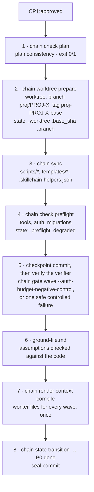

# How the Chain Works

Start here if you have not used the chain before. This page explains the part that is easy to miss from the skill list: **which steps are scripts that refuse to continue, and which are an agent's judgment**, and how a PROJ moves from the approved plan (P0) to the pull request (P8). The step-by-step skill roles are in [skill-chain.md](skill-chain.md); installation is in [installation.md](installation.md).

## Two layers

- **Skills** are written procedures an agent follows (concept, requirements, architecture, plans, executing, QA, docs, delivery). They decide things.
- **Scripts** are small deterministic programs the skills call. They record state, check gates, render documents and manage the worktree. They apply fixed rules and either succeed or refuse; choosing scope, assessing findings and approving work stays with agents or humans.

Every script is reached through one entry point, **`chain <verb> [] [args…]`**. A synchronized repo has it at `scripts/chain` (`bash scripts/chain state get …`); before the first sync, call the installed copy `~/.claude/skills/5_executing/scripts/chain` (Codex: `~/.codex/skills/…`), which finds all helpers in the installed skills. `chain` only looks up the script and runs it unchanged: same arguments, same exit code, same output. `chain --list` prints the table below, `chain --where <verb> []` prints the script it would run.

## The five script kinds

Every dispatcher action belongs to exactly one kind. A script can implement actions of different kinds: `chain quality` records evidence while `chain quality seal` checks it. Only Record actions directly write `state.json`, `findings.json` and `quality-*.json`; other helpers delegate changes to those writers. Other outputs, such as `ralph-wave-N.json`, belong to the gate producing them; Renderers write only their output documents (`chain render context` also refreshes the `skillchain-*` agent files); Gates answer with an exit code and a report.

| Kind | Contract | `chain` verbs → script |
|---|---|---|
| **Record** | The only way to write one file. Validates every write. | `chain state` → state.sh · `chain findings` (with `chain findings harvest`) → findings.mjs · `chain quality` → quality.mjs |
| **Gate** | Refuses to continue: exit 0 or non-zero, report on stdout. | `chain gate wave` → wave-gate.sh · `chain check risk` → risk-check.sh (always exit 0, the `fast`/`full` verdict is line 1) · `chain quality seal` → quality.mjs · `chain check inputs` → resolve-inputs.mjs · `chain check prds` → validate-prds.mjs · `chain check architecture` → validate-architecture.mjs · `chain check plan` → validate-wave-plan.mjs · `chain check preflight` → preflight.sh · `chain check migrations` → migration-drift-check.sh · `chain check caps` and `chain check intake` → curation.sh · `chain check conflicts` and `chain check ci` → delivery.sh |
| **Renderer** | Turns data into a document. Never writes `state.json`, `findings.json` or `quality-*.json`. | `chain render context` → compile-context.mjs · `chain render slice` → story-slice.mjs · `chain render registry` → gen-component-registry.mjs · `chain render pr` and `chain render report` → render.mjs |
| **Environment** | Changes the repo or the machine: worktree lifecycle, helper sync. | `chain worktree` → worktree.sh · `chain sync` → sync-framework.mjs |
| **Review** | Starts a reviewer from the opposite provider and normalizes what it returns. | `chain review` → cross-review.sh · `chain review claude` → review-with-claude.sh · `chain review codex` → review-with-codex.sh |

Stack-specific add-ons are separate scripts on purpose, so projects without that stack are unaffected: `chain check migrations` (Supabase projects) and `chain render registry` (projects with a component library). `chain check preflight` and `chain gate wave` call them when they apply.

Not behind `chain`: `env-local.sh` and `compat.sh` (libraries the gates `source`), `merge-project-settings.sh` (Claude only, run once per project by hand), and the phase runner `runner/run-phase.sh`, which drives unattended runs.

Document structure is checked where it is produced: Step 2 runs `chain check prds <prd-directory>` before user/provider review and after edits. Step 3 validates its PRD inputs, then runs `chain check architecture <architecture-file> <prd-directory>` before architecture review. Step 4 checks both inputs before planning and checks its plan/config output. CP1 repeats all three gates before approval. These gates do not judge completeness or technical sense. New validators exit 0 for valid structure, 1 for invalid documents, 2 for unreadable input and 64 for wrong invocation; they write nothing.

The shared document and architecture readers do no I/O or process control. Their adjacent copies are byte-checked, and sync installs one copy of each into the project's flat scripts directory. Context compilation and story slicing use the same readers while keeping historical exit codes and legacy architecture fallbacks. Older artifacts passed back into Steps 3, 4 or CP1 must be corrected by the owning skill; already approved P5 runs gain no retrospective document gate.

## External product inputs

An explicit `external-handoff.json` in the PROJ directory selects the optional
[receiving contract](../codex/skills/2e_handoff-refinement/references/input-contract.md).
The resolver and findings helpers refuse a marker beside `2b_handoff/`: refinement
never shares the source product project.
`chain check inputs <project-directory>` checks hashes, source identities, scope,
response provenance and readiness. `--allow-blocked` bypasses readiness blockers
only for read-only refinement of structurally valid inventories. A requirement
with `repositories: []` is an explicit `ownership unresolved` blocker rather than
a forced mapping. Missing mappings for owned requirements, invalid structure and
integrity failures still fail; the flag never authorizes implementation. Existing linear PRD checks remain
unchanged when no marker exists.

PRD/architecture/plan gates, context compilation and story slicing use the same
input resolver. Worker and reviewer contexts receive approved responses and
separate engineering criteria with source provenance, plus relevant unresolved
questions and unapproved answers clearly marked as non-authoritative. Complex
source criteria can use the lossless `external-ac` literal described in the
[receiving contract](../codex/skills/2e_handoff-refinement/references/input-contract.md#consumers-and-checks):
Markdown boundaries, CRLF and significant whitespace remain intact, and exact
source comparison still applies. Received product files are never normalized to
fit the plan parser.

After changing external inputs or product answers, rerun
`chain render context compile <X> <theme>` before spawning workers. The companion
`chain render context check <X> <theme>` validates freshly rendered content in
memory; it does not compare existing worker files with that content or certify
their freshness. Framework sync installs the shared reader with its consumers.
QA evidence stays outside immutable source files. `chain render pr`
includes repo scope, dependencies and shared integration evidence; an absent or
stale shared report remains pending even if the current repo's tests pass.

Optional `engineeringStories` declarations give standalone technical work IDs
such as `PROJ-7-ENG-US-1`, with rationale, engineering authority and testable
`ENG-AC-*` criteria. The same gates reject undeclared stories and missing criteria;
architecture records their coverage, and worker contexts carry their technical
constraints and applicable approved product answers. A repository can own only
technical stories without synthetic product PRDs. Dependencies use the existing
wave order and pinned repository prerequisites. Ordinary implementation details
remain tasks within their product story.

## The phases at a glance

The state machine in `state.json` has the phases `CP1 → P0 → P5 → P6 → P7 → P8 → done`. Step 1 (concept) creates `state.json` with the PROJ folder on the linear route; `handoff-refinement` initializes each implementation repo's local state on the external route. New state stays `CP1:pending` until Checkpoint 1 approves architecture and plans. The phase numbers P5–P8 follow the step numbers 5–8, and P0 is the setup that precedes step 5's implementation work.

| Phase | Call | Reads | Writes |
|---|---|---|---|
| **CP1** — approve the plan | `chain check prds`, `chain check architecture`, `chain check plan`, `chain render context check`, then `chain state transition … CP1 approved` | wave plans, `wave-gate-config.json`, PRDs | `state.json` via `chain state` (phase, and the path of the decision log); the log itself, `decisions.md`, is written by the checkpoint subskill |
| **P0** — setup | see the P0 diagram below | the approved plans, `docs/` | worktree, `state.json`, `scripts/`, worker files |
| **P5** wave start | git tag `wave-N-start-PROJ-X`, `chain render context compile <X> <theme> --wave N` | the wave plan, `progress.md` | `context/workers/wave-N/*.md` |
| **P5** worker | reads its one file; `chain worktree with-shared-lock -- <cmd>` for migrations and auth commands | its worker file | code and tests |
| **P5** wave gate | `chain gate wave --ac-only N`, then `chain gate wave N`, then `chain state set … .waves` | code, `wave-gate-config.json` | `ralph-wave-N.json`, the `### Wave N Gate — PASSED` block in `progress.md` |
| **P5** quality gate | `chain quality <X> <theme> run build\|coverage\|sonar\|lint`, `chain quality <X> <theme> review <report>`, `chain quality seal` | build, tests, Sonar, the integration review | `5_progress/quality-*.json`, the rendered `### Gate Status` block of the `## Quality Gate` section in `progress.md`, then `chain state transition … P5 done` |
| **P6** — QA | `chain review qa`, `chain findings add`, `chain findings stats` | the diff `BASE_SHA..HEAD`, PRDs, architecture | `findings.json`; the runner stores the finder's text report |
| **P7** — documentation | `chain check caps`, `chain review docs`, `chain state set … .authorship` | `docs/*`, `AGENTS.md`, the QA report | `docs/*` |
| **P8** — delivery | `chain check conflicts`, `chain findings harvest`, `chain findings auto-defer`, `chain findings stats`, `chain render pr`, `chain check ci`, `chain worktree cleanup` | `state.json`, `findings.json` | the PR body (rendered), `.pr` in `state.json`, the removed worktree |

The lead orchestrates these calls, creates the wave-start tags and maintains the narrative in `progress.md`; gate scripts append their own result blocks. Record commands are the only writers of the three JSON records listed below, regardless of who invokes them. P8 creates the PR and checks its final head; CP2 lets the human review and merge; it is a human handoff, not another machine phase. P8 can finish its autonomous checks while the PR is open. Worktree cleanup follows the merge and repeated safety checks, as specified in [delivery](../claude/skills/8_delivery/SKILL.md).

## P0: one setup run

P0 runs once per PROJ, right after CP1. Scripts check fixed rules; the setup agent validates the ground-file assumptions and chooses a safe fallback negative control when needed. There are no questions to the user.

The checkpoint commit in step 5 is an ordinary Git commit that gives the verifier a clean working tree; it is separate from the human approvals CP1 and CP2. “Verify the verifier” means exercising a safe, expected failure through the real gate: the auth-budget negative control where configured, otherwise a temporarily broken assertion, policy or build followed by restoration and a green rerun. The setup agent records commands and outcomes in `progress.md`; an unexplained failure does not count. It also writes the ground file after checking its assumptions against the code. See the [setup procedure](../claude/skills/5_executing/subskills/setup.md) for the exact commands.

P0 compiles all worker files once after the ground file exists. At each P5 wave start, the lead refreshes that wave's files from the current sources before dispatching workers. This refresh is separate from the single P0 compile.

The permission setup (`merge-project-settings.sh`, Claude only) is a separate manual one-time step. It installs an allowlist with `defaultMode: acceptEdits`; full bypass (`--dangerously-skip-permissions`, or `SKILLCHAIN_SKIP_PERMISSIONS=1` for the runner) is an explicit opt-in, never the default.

## What a worker file contains

A worker reads exactly one compiled file, named by path in its spawn prompt. Nothing is pasted into prompts. `chain render context` writes one file per story, `context/workers/wave-N/<US-ID>.md` (`<US-ID>.backend.md` and `.frontend.md` for a contract split), and one per role without a story, `context/roles/wave-N/<role>.md` (reviewers and fix workers). Sections appear in this order:

| Section | Source |
|---|---|
| Header line: plan path, plan hash, role, wave | the wave plan `3-4_plan/PROJ-X-wave-N-plan.md` |
| Role rules | the role manifest `templates/roles/<role>.md` (preamble) |
| Project context for the role (its `inject` list) | `docs/PRODUCT.md`, `ARCHITECTURE.md`, `GUIDELINES.md`, `DESIGN-SYSTEM.md` or the security baseline, `ground-file.md` |
| PROJ architecture, filtered to the PRDs of the wave | the PROJ architecture document |
| API contracts of the wave | architecture and plan |
| `## Your Story` (story files only: story, ACs, gate commands) | the wave plan, cut out verbatim by `chain render slice` |

The role comes from the `Agent Type` column of the wave plan. Micro-fixer and explore spawns get no file. Whole PRDs, other stories' plans, `progress.md` and `agent.md` files are never injected. A role over its token budget makes `compile` fail before anything is written.

The nine baseline files are root `AGENTS.md`, plus `docs/PRODUCT.md`,
`ARCHITECTURE.md`, `GUIDELINES.md`, `DESIGN-SYSTEM.md`, `components.md`,
`security-baseline.md`, `test-conventions.md` and `review-checklist.md`.
DESIGN-SYSTEM and components are required only when component directories exist.
GUIDELINES contains target-state rules plus ≤10 top-level `## Traps` entries within
120 lines. The required review-checklist is capped at 80 lines, with project-specific
Antipatterns (detection signal + severity) and Known Debt (do not re-flag, do not spread).
Generic Don’ts stay in chain role manifests, without duplicates in project Traps.
Reviewers receive a checklist path reference; QA reads it with its generic Simplicity
catalog. Every implementer bundle excludes it; Inner Ralph reads it by path only
after writing. See the [trap test](../CONCEPT.md#trap-test-and-rule-placement).

## Three files, three writers

| File | Only writer | Never |
|---|---|---|
| `specs/PROJ-X-theme/state.json` — phase, status, worktree, preflight, cross-review rounds, PR | `chain state` (schema-checked, illegal phase transitions refused) | hand edits, raw `jq` writes |
| `specs/PROJ-X-theme/findings.json` — the findings ledger | `chain findings` (deduplicates, normalizes severity) | hand edits, raw `jq` writes |
| `specs/PROJ-X-theme/5_progress/quality-*.json` — command evidence of the quality gate | `chain quality` (records command, commit, input fingerprint, exit result, log hash; renders the status block that `chain quality seal` compares with the records) | fabricated evidence |

Reports and the PR body are rendered from these files by `chain render report` and `chain render pr`, never written or edited by hand. The reading side is free: any skill may read the three files.

## Which gate is a script, which a review

A gate is either a **script** (deterministic, same answer every time), an **LLM review** (a reviewer from the opposite provider, whose findings go into the ledger), or a **human** approval. The unattended runner re-checks the script gates itself. In an interactive run, the lead follows the same gate order. First the AC-only pass checks the wave's acceptance criteria; only a green result permits the full wave gate, and only that gate passing permits the next wave.

| Gate | Kind | Call |
|---|---|---|
| Plan consistency (CP1, P0) | Script | `chain check plan` |
| Plan, concept, requirements, architecture review | LLM review | `chain review plan` (and the other modes) |
| Checkpoint 1 approval | Human | the checkpoint subskill; nothing is approved on the user's behalf |
| Tool and auth preflight, migration drift | Script | `chain check preflight` |
| Acceptance-criteria checks inside Outer Ralph | Script | `chain gate wave --ac-only N` |
| Wave gate: ACs, regressions, build, browser smoke | Script (CodeRabbit runs inside it as one input) | `chain gate wave N` |
| Integration review at the end of P5 | LLM review | a reviewer worker; its report is bound with `chain quality … review` |
| Quality gate evidence | Script | `chain quality seal` |
| QA: acceptance, security, six-persona panel | LLM review | `chain review qa` |
| No open Critical or High finding (P6, P8) | Script | `chain findings stats` |
| Documentation form (line caps) | Script | `chain check caps` |
| Documentation truth | LLM review | `chain review docs` |
| Intake baseline seal | Script | `chain check intake` |
| Merge conflicts against main | Script | `chain check conflicts` |
| CI on the final head | Script | `chain check ci` |
| Checkpoint 2 (PR review comments) | Human | the checkpoint subskill via delivery |

## Glossary

- **PROJ** — one numbered unit of work with its own concept, PRDs, architecture, plans, execution, QA and docs, under `specs/PROJ-<X>-<theme>/`.
- **CP1 / CP2** — Checkpoint 1 is the single human approval of the planning package before any code; Checkpoint 2 reconciles the review comments on the pull request.
- **P0 … P8** — the framework phases. P0 setup, P5 implementation, P6 QA, P7 documentation, P8 delivery. Each ends with a script-verified seal in `state.json` (`P5:done`).
- **Wave** — a dependency-ordered group of stories that can be built together. Wave N+1 starts only after wave N's gate passed.
- **Worker file** — the one compiled context file a worker reads (see above).
- **Ground file** — assumptions the plans rely on, each validated against the codebase, limited to what `docs/` does not already say.
- **Ralph** — the bounded verification loop. *Inner Ralph* is one self-review by each worker; *Outer Ralph* is the lead's wave-scoped pass over the acceptance criteria with four fixed recovery stages.
- **Quality Gate** — the PROJ-level gate after the last wave: declared quality commands, build, coverage, lint, Sonar and an integration review of `BASE_SHA..HEAD`, sealed by `chain quality seal`.
- **Ledger** — the stage-local `findings.json` files, read together as one PROJ fix queue.
- **Cross-review** — a review by the opposite provider (a Claude author is reviewed by Codex and the reverse), started with `chain review`.
- **degraded** — set in `state.json` when Codex is missing or unauthenticated: the run continues single-provider with a model-opposite review, flagged in the morning report and the PR body, never silent.
- **BASE_SHA** — the commit the PROJ branch started from; QA and docs review the diff `BASE_SHA..HEAD`.

## Stage-local review findings

Reviews inside a PROJ retain findings beside their phase artifacts: concept in
`1_concept/`, requirements in `2_PRDs/`, architecture and plans in `3-4_plan/`,
implementation in `5_progress/`, QA in `6_qa/`, documentation in
`7_documentation/`, delivery in `8_delivery/`; each file is named `findings.json`.
`chain findings list <X> <theme>` aggregates all stage ledgers plus an existing
legacy root ledger. There is no generated central copy. IDs are unique per
PROJ, status updates preserve the owning file, and gates/reports read the
aggregate. `chain findings add <X> <theme> --stage <mode>` selects a phase; the
default is implementation. Concept and requirements persist without runtime
state; `--persist` additionally records a review round in existing state.json.
Outside a PROJ directory, cross-review prints findings without saving files or
creating a project. Clean reviews do not create an empty findings file.
