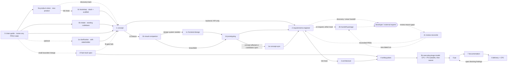

# Skill Chain

## Artifact language

From Requirements Engineer (Step 2) onward, all newly authored artifacts are
English, including PRDs, review findings, plans, handoffs, worker/QA reports,
documentation and PR descriptions. Conversation may use the user's language.
Identifiers, verbatim source evidence and required product localization are
preserved. In the local authoring path, non-English canonical ACs are revised and approved
in their owning PRD before downstream verbatim copying; a planner does not
translate them. Received product ACs remain verbatim in their original language.

## Flow

**Before the first PROJ, once.** A new product runs
[`product-vision` (0a)](../claude/skills/0a_product-vision/SKILL.md) and then
[`bootstrap` (0c)](../claude/skills/0c_bootstrap/SKILL.md); an existing codebase
runs [`intake` (0b)](../claude/skills/0b_intake/SKILL.md) instead, which reaches
the same curated baseline by extraction. Run one path, not both; the discovery
track skips 0c because there is no codebase.

The chain serves two delivery tracks: the full in-repo build (Steps 1–7) and a **product discovery** track that stops at Step 2 and hands a PRD to a developer via Linear. See [PM / Product Discovery Chain](pm-chain.md).

PRD structure is checked before Step 2 review; Step 3 checks PRD inputs and architecture output; Step 4 checks both inputs and its plan/config output. CP1 repeats all three checks before approval. Failures return to the owning skill; reviews still judge meaning and completeness.

Through Step 4, each producing skill has its own user-started session, including the optional discovery skills. Finish the current skill's checks, automatic cross-review, reconciliation and required user review before handing off. End with a copyable prompt containing the next skill, workspace, PROJ, actual artifact paths and blockers; the next session reloads these inputs. Internal helpers and cross-review stay in the current session. `/compact` does not satisfy this boundary. Architecture hands off to writing-plans in a new session, and writing-plans hands off to Step 5 in another new session. Checkpoint 1 remains the joint approval of architecture and plans; no additional approval gate is introduced. Blocked artifacts return to their owning skill through the same session boundary.

`cross-review`, `bugfixing`, `refactor-dreamer`, `sonar-cli`, `update-chain` and `vibecoder` intentionally sit outside this flow. Step 5 has two skills with identical gates and state contracts: `5b_executing-large-model` is the default, with procedure reduced to invariants; `5_executing` is the full-procedure alternative for weaker writer models and hosts the shared subskills, scripts and the references both skills point to — shared rules live there once, and `validate.sh` caps 5b at 350 lines. `cross-review` is a mechanism, not a step — it is invoked by producing skills and never routed to directly, which is why it carries no chain number. Concept, requirements, architecture, and plan reviews start automatically as soon as their outputs are saved and applicable structure/cap checks pass, before user approval or handoff. Concept and requirements repeat the review automatically after user-requested changes. P6 QA and P7 documentation also require it. Use `bugfixing` for a reported defect that needs reproduction, a narrow repair, regression-test proof, and test-escape analysis without starting a feature PROJ. Launch `refactor-dreamer` separately for a long-form architecture drift/refactor discovery run, then feed its `chain-input.md` into the appropriate chain step. Use `sonar-cli` separately for SonarScanner/SonarQube CLI setup, analysis runs, and issue triage. Use `vibecoder` for a freeform exploratory coding session on a scratch branch: it keeps a live journal while you experiment, then distills it into a `chain-input.md` that feeds `1_concept` as raw input.

## External product handoffs

This optional receiving step is numbered `2e` because it sits on the
engineering side of Stage 2 and joins the existing chain at architecture:
`handoff-refinement` (2e) → architecture (3) → plans
(4) → per-repo execution, QA and delivery → shared integration verification.
From Step 3 on, the receiving route runs in the production repository like the
linear chain. Each producing
skill hands off through a copyable prompt to a new user-started session.
The linear route requires no workspace inventory, external marker, additional
approval or migration.

[`handoff-refinement`](../codex/skills/2e_handoff-refinement/SKILL.md) first discovers
the team coordination remote and reuses its checkout, safely clones it, or creates a
missing remote within the user's authorization. The repository that produced the
handoff or an implementation repository can own the tracked coordination location
equally; a separate repository is optional and is the only case that creates a
new remote. Refinement projects sit beside, never inside, the source product
project.
Access denial is an access problem, and local-only staging is explicitly chosen
and remains unpublished. A plain common parent directory is convenient, never
required. Portable repository identities (`delivery-workspace.json`) belong in version control; each
developer's checkout paths and credentials do not.

It reports each implementation repository's baseline separately: reuse an
accepted baseline revision, resume an interrupted intake, offer `intake` for
existing code without a baseline, or route genuinely new code to bootstrap.
Check for active team intake work before starting another. A local seal or open
PR does not prove team acceptance. Coordination-only repositories need no app
intake. These distinctions do not add team PR gates to standalone linear use.

It then fingerprints
the received package and records source identities, code evidence, technical
constraints, repo ownership, dependencies and product questions. It can inspect
a handoff and prepare questions before every repo has finished intake. Prototype
references describe interactions and simulated behavior; static references can
be sufficient and runnable prototypes do not establish production architecture.

Each refinement is stored as a run under `specs/PROJ-<id>-<theme>/runs/<YYYY-MM-DD-NN>/`
(in the handoff's source repository a `-refinement` sibling of the product project)
with the received files byte-identical under `handoff/<version>/` and all new
results under `refinement/`. The run README's provenance table states for every
path whether it was received unchanged, extracted, newly written, generated or
derived, and whether it is immutable, an observation, a proposal, a question, a
checked result or an approval by a named owner. Review rounds and resumed
sessions stay in their run; a new handoff version or a deliberately fresh
assessment opens a new run and keeps the old one. Ownership that is still open
stays `ownership unresolved` in the inventory instead of being assigned to the
inspected repository. See the
[run layout](../codex/skills/2e_handoff-refinement/references/run-layout.md).

Before a repository's refinement review and architecture handoff,
`handoff-refinement` initializes its local PROJ state through `chain state init`.
New state remains `CP1:pending`; existing state is retained, and only the Step 5
checkpoint can approve CP1. Execution state stays in the owning implementation
repo, never in portable input bundles or shared coordination. A missing checkout
is an onboarding prerequisite, not a reason to create its state elsewhere.

Each repeat round assesses current requirements against current authoritative
inputs before reconciling earlier findings. Prior items retain their IDs and
are accounted for as open, resolved with evidence, superseded or needing
reassessment. Changed rules, approved answers or engineering constraints trigger
checks of affected requirements even when their PRD text is unchanged. No new
findings does not mean earlier questions are answered; see the
[repeat-round procedure](../codex/skills/2e_handoff-refinement/SKILL.md#repeat-rounds-and-package-consistency).

The [external input contract](../codex/skills/2e_handoff-refinement/references/input-contract.md)
is the common reference for validators and context generation. The explicit
`external-handoff.json` marker selects external mode; a malformed marker fails
rather than falling back to local PRDs. Product files stay immutable. Local
story aliases map to namespaced source criteria; technical checks remain
separate. Technical work normally remains a task within its product story. An
independently verifiable prerequisite, such as a shared migration, can instead
be an optional engineering story (`PROJ-<X>-ENG-US-<N>`), with its own rationale,
authority, `ENG-AC-*` criteria and dependencies. It uses the same architecture,
wave planning, worker and test gates without creating a replacement product PRD.
Explicit product responses carry owner, date and baseline provenance.
New upstream baselines or answers require impact reconciliation and renewed
readiness checks for affected work. Team acceptance follows existing review
policies; a locally drafted revision or open PR is not an accepted baseline.

Questions return as a portable package to product-side `review-reconcile`;
preparing it does not send or publish it. Product owns the source revisions and
`handoff-package` produces a new dated run when appropriate. Engineering never
rewrites the received PRDs to make the local-format validator pass. Unresolved
product decisions block only their applicable scope, and a reviewer cannot
supply product authority.

Each repo consumes a pinned self-contained bundle or reproducible input source,
with its own local PROJ, execution state and tests. Plans allocate owned work and
external dependencies without duplicating all requirements into every repo.
QA writes evidence outside product inputs. The coordination location tracks
aggregate requirement coverage, compatible revisions, integration evidence and
release order; one green repo or open PR cannot establish whole-feature delivery.
No cross-repo scheduler, automatic merge or deployment is introduced.

## Legacy PROJ Folders

PROJ folders created before the layout rename use the old subfolder names
(`2_visual-companion/` → `1b_visual-companion/`, `4_design/` → `1c_design/`,
`5_mockups/`, `1d_mockups/` → `1d_prototypes/`, `3_PRDs/` → `2_PRDs/`, `8_handoff/` →
`2b_handoff/`, `6_plan/` → `3-4_plan/`, `7_progress/` → `5_progress/`).
Every skill reads the legacy name when the current one is missing, keeps
writing where the files already are, and offers the rename once. Nothing
blocks on it — a `git mv` per folder plus a path search inside the PROJ's
own documents is the whole migration, and skipping it is a valid answer.

## Decomposed Ideas

Step 1 clarifies the problem before comparing solution directions. Optionally, the PM first runs `clarification` (1a) live with the stakeholder; it writes a standalone `specs/_clarification/<slug>-stakeholder_brief.md` that the PM later hands to `concept`. If a brief or other usable clarification artifact is supplied, `concept` reads it and skips the questions it answers. The concept records its source and carries the problem, success factors, non-goals, and constraints forward. A brief file is optional; no gate record is required. After clarification, Step 1 can split a broad seed into several PROJs before detailed concept intake. This is for product boundaries, not task management: PRDs split behavior inside one PROJ, and waves split implementation order.

After decomposition:

- Each PROJ gets its own concept, PRDs, architecture, plans, execution, QA, and docs.
- Downstream skills work one PROJ at a time and treat sibling PROJs as dependencies, context, or future scope.
- `frontend-design` may be shared across tightly linked UI PROJs through one canonical `1c_design/design-language.md` with an `Applies To` section.
- `visual-companion` and `prototyping` stay scoped to the current PROJ unless the user explicitly requests a combined UI review.

## Step Roles

| Step | Skill | Purpose |
|---|---|---|
| 0 | chain-guide | Detect current PROJ state and recommend the next step; advise which flow fits a new task |
| 0a | product-vision | New product: `docs/PRODUCT.md` (what/who/non-goals) + the numbered PROJ map with dependencies |
| 0b | intake | Existing codebase: bootstrap the curated `docs/` baseline by scan + interview, sealed via the checkpoint bootstrap variant |
| 0c | bootstrap | New build: stack into `docs/ARCHITECTURE.md` § Stack, real scaffold with build/test verified green, root `AGENTS.md` + `CLAUDE.md` pointer |
| 1a | clarification (optional) | PM and stakeholder clarify the problem live into a standalone stakeholder brief: job to be done, owner, success factors with baselines and targets, non-goals, constraints, open questions |
| 1 | concept | Clarify the problem or use a supplied brief, open the solution space, then compare directions and write a buildable feature concept |
| 1b | visual-companion | Explore UI structure before requirements; with open candidate directions, build one approach per candidate and narrow the set |
| 1c | frontend-design | Define the design system for greenfield or hybrid UI work: tokens, component catalog, and the `/dev/components` showcase |
| 1d | prototyping | Create component mockups in the PROJ folder using the existing app runtime, or standalone HTML without one; track iterations and runtime details in the handoff; with several carried-forward candidates, prototype each until one remains |
| 1e | concept-sync | Reconcile iterated mockup changes and the chosen candidate direction back into the concept; set delivery track |
| 1f | fast-track-spec | Compressed entry for a small, bounded, non-bug change: thin concept, one PRD and the architecture in one session, one interview, one cross-review; standard artifacts, so Step 4 onward is unchanged; escalates to `concept` when the fit gate fails |
| 2 | requirements-engineer | Write PRDs, user stories, acceptance criteria, and edge cases; pass the required opposite-provider review before full-chain or Linear handoff |
| 2b | handoff-package | Assemble a standalone, zippable handoff package for external UI/UX experts and developers (discovery endpoint or requested full-chain export) |
| 2c | review-reconcile | Resolve PRD review gaps point by point; defer engineering items to a developer meeting (discovery endpoint or requested full-chain export) |
| 2e | handoff-refinement | Receiving side of an external handoff: locate or set up the team coordination location, route baseline intake per implementation repo, refine the immutable package against code, return product questions, prepare pinned per-repo inputs for Step 3 |
| 3 | architecture | Produce the PROJ technical architecture for developers |
| 4 | writing-plans | Split independently verifiable stories into dependency-ordered waves; use expand–contract for wide migrations |
| 5b | executing-large-model | Default Step 5: Checkpoint 1 and P0 through `5_executing`'s subskills, then the waves under the same gate and state contracts, with procedure reduced to intent and invariants ([SKILL.md](../claude/skills/5b_executing-large-model/SKILL.md)) |
| 5 | executing | Full-procedure alternative for weaker writer models; hosts the checkpoint and setup subskills, the framework scripts and the shared references ([SKILL.md](../claude/skills/5_executing/SKILL.md)) |
| 6 | qa | Run E2E QA, security, the required opposite-provider six-persona review (the only persona panel), simplicity review (what the Step 5 static and mutation gates cannot decide), and mutation-survivor input; strictly read-only finder in framework runs |
| 7 | documentation | Curate feature and technical docs, then merge approved AGENTS.md candidates |
| 8 | delivery | Conflict probe against main, PR body rendered from state.json + findings.json and declared external prerequisites in wave-gate-config.json, bounded CI fix loop, Checkpoint 2 comment reconcile |

## Framework Runs (Agent Workflow, Stage 1 + Stage 2)

The script map (`chain <verb>`), the P0–P8 phases and which gate is a script or a review are on one page: [how-it-works.md](how-it-works.md). This section keeps the runner mechanics and points to the one source of each contract.

**Unattended runs, stop policy, morning report.** Once Step 5 has sealed P0,
it asks once whether to run P5 to the PR unattended, drive it in the current
session, or continue interactively
([unattended-handoff.md](../claude/skills/5_executing/references/unattended-handoff.md)).
The detached runner drives P5 → P6 → P7 → P8 with dual Claude + Codex lanes, one
writer-orchestrator per phase and `state.json`/`findings.json` as the only
handoff; a failed writer, timeout, unsealed phase or red gate parks the run with
a rescue branch and a rendered stop report instead of continuing degraded, and a
missing or unauthenticated `codex` degrades to a model-opposite review lane,
flagged, never silent. The invariants, the pinned models and the stop policy are
in [runner/README.md](../runner/README.md#invariants-the-runner-owns); the stop
report is rendered from
[stop-report.md.tmpl](../claude/skills/5_executing/templates/stop-report.md.tmpl)
and the cross-PROJ morning report on demand with
`bash ~/.claude/skills/5_executing/scripts/chain render report morning specs`.

**Worktree and shared resources.** P0 creates or resumes a persistent sibling
worktree for `proj/PROJ-X` that the runner re-enters for every later phase;
source and dependencies are isolated, while `.env.local`, the development
database and the hosted-auth budget are explicitly shared. Migrations and
auth-consuming commands run under `chain worktree with-shared-lock`
(exclusive by default; proven independent fixture lifecycles may opt into
`--shared`), and `chain check preflight` plus every `chain gate wave` run
`chain check migrations` on Supabase projects. The worktree contract is in
[setup.md §1](../claude/skills/5_executing/subskills/setup.md), lock diagnosis
and worker handover in
[worker-lifecycle.md](../claude/skills/5_executing/references/worker-lifecycle.md),
and the guarded post-merge cleanup in
[8_delivery/SKILL.md](../claude/skills/8_delivery/SKILL.md) (the worktree stays
while the PR is open and is removed only after an authoritative `MERGED` state
with green CI on that exact head).

**Wave gate.** Wave plans carry structured AC/test-file mappings, targeted
regressions, auth-budget metadata and deterministic route expectations, and
`chain gate wave` certifies the current wave's ACs plus declared regressions —
not every earlier AC — so structure and quality are judged by tools that fail
(optional `complexity_cmd`, `arch_rules_cmd`, `selection_check_cmd`) and fed
back through the existing recovery stages, not by a cleaner agent. An
authorized `external_dependency` keeps the AC and test and parks the wave as
`blocked_external` (exit 76) without a certificate. The gate contract is the
[Wave Completion Gate](../claude/skills/5_executing/SKILL.md#wave-completion-gate),
the config fields and judgment rules are in
[wave-gate-config.md](../claude/skills/4_writing-plans/references/wave-gate-config.md),
and the recovery stages in
[Wave-Scoped Outer Ralph](executing-skill.md#wave-scoped-outer-ralph).

Stage 2 adds the bootstrap and the full context system:

- **`intake` (0b), once per repo:** scan → provenance-marked drafts of the
  curated docs baseline → developer interview → checkpoint-subskill bootstrap
  reconcile → sealed baseline commit (`chain check intake`; no state.json —
  concept (1) creates one per PROJ). See
  [0b_intake/SKILL.md](../claude/skills/0b_intake/SKILL.md).
- **Worker context files:** every story or role worker reads exactly one compiled file named
  by path in its spawn prompt (micro-fixer and explore spawns get none) — nothing is pasted, no hook, no lock — so a
  story's context is bounded by its role's token budget and the plan hash on
  the file's first line. The P0 sequence and the file layout are in
  [how-it-works.md](how-it-works.md#p0-one-setup-run) and
  [What a worker file contains](how-it-works.md#what-a-worker-file-contains);
  the compile step in
  [setup.md §6](../claude/skills/5_executing/subskills/setup.md); what each
  role gets (`inject` lists and budgets) in the
  [role manifests](../claude/skills/5_executing/manifests/roles/).
- **Minimal by default:** the minimalism rules are part of the implementer
  role manifests (and `micro-fixer`), so every tier-1 worker file carries
  them; no plugin is gated for it (the Ponytail plugin was retired 2026-10-26,
  [CONCEPT.md §7](../CONCEPT.md)).
- **P7 curation + gates:** `documentation` (7) curates `docs/` and
  `src/**/agent.md` in place, then must pass FORM (`chain check caps`; all
  caps are defined once in that script's header — `chain check caps --help`
  prints them) and
  TRUTH (a `cross-review` of the docs delta against the PROJ diff; Critical/High
  block the phase). The runner re-verifies both gates after the seal.
- **`cross-review`:** symmetric opposite-provider review mechanism — a Claude
  author is reviewed by Codex and the reverse; without Codex the strongest
  non-author model takes over, flagged degraded (the six-persona QA fallback
  runs on the strongest Claude model even when it is the author's). Active call sites: required
  PRD review in Step 2, automatic concept/architecture/plan reviews, the required
  P6 QA six-persona review, and the P7 docs truth gate. Routing, rounds and
  size limits are in
  [cross-review/SKILL.md](../claude/skills/cross-review/SKILL.md#routing-and-output-integrity);
  the pinned writer/review models in
  [runner/README.md](../runner/README.md#invariants-the-runner-owns).
- **Integration-focused PROJ gate:** once every wave passes, the PROJ quality
  gate reviews only the assembled cross-wave diff from `BASE_SHA` rather than
  replaying wave ACs, plus build, declared quality-phase tests, lint, optional
  mutation hardening and Sonar once at PROJ end; Sonar and mutation survivors
  that outlive their bounded fix rounds are carried forward to QA instead of
  blocking. The gate sequence, status lines and carry-forward rules are in
  [quality-gate.md](../claude/skills/5_executing/references/quality-gate.md);
  the overview in [PROJ Quality Gate](executing-skill.md#proj-quality-gate).
- **Hard gates:** P6 cannot seal with an open Critical/High finding. P7
  cannot seal unless the curated docs pass both FORM (`chain check caps`)
  and TRUTH (a `cross-review` that actually ran this P7 with no blocking
  findings left). The runner independently re-verifies every gate after its
  seal.
- **Bounded evidence retention:** CodeRabbit's raw output is kept because
  the local gate parses it; CI and Sonar reports stay in their source
  systems, while the PROJ gate retains only command logs and task-receipt
  hashes. `cross-review` persists validated normalized findings, not full
  model responses that may carry sensitive context.

For a detailed explanation of Step 5 loops, gates, proof files, and QA handoff, see [Executing Skill](executing-skill.md).

## Optional Skills

| Skill | Purpose |
|---|---|
| bugfixing | Reproduce and diagnose one reported defect, prove a regression test red before the fix, dispatch a narrow repair, run at most three Ralph repair attempts, and explain why prior tests missed it; standalone evidence lives in `specs/_bugfixing/BUGFIX-YYYYMMDD-HHMM-<slug>/bugfix-report.md` |
| refactor-dreamer | Run an overnight/deep codebase scan for architecture drift, larger refactor opportunities, ADR candidates, fitness functions, and chain-ready input |
| vibecoder | Freeform exploratory coding on a scratch branch with a live-appended journal, distilled at wrap-up into a `chain-input.md` feature seed for `1_concept` |
| update-chain | Clone the upstream skill-chain repo, show which installed skills change, and run the installer for the current provider; project helper copies are left to Step 5's `chain sync` |
| sonar-cli | Set up and operate SonarScanner CLI and SonarQube CLI for project analysis, quality gates, and issue triage |
| supabase-local-dev | Diagnose shared-local-Supabase-DB problems outside the chain's own P0/wave-gate flow: migration drift between git worktrees sharing one Postgres instance (keyed by `config.toml`'s committed `project_id`), RLS/grant surprises from testing as the `postgres` superuser, and `config.toml` vs. deployed truth; same `chain check migrations` check |

Claude-specific experimental or personal skills are intentionally excluded.
